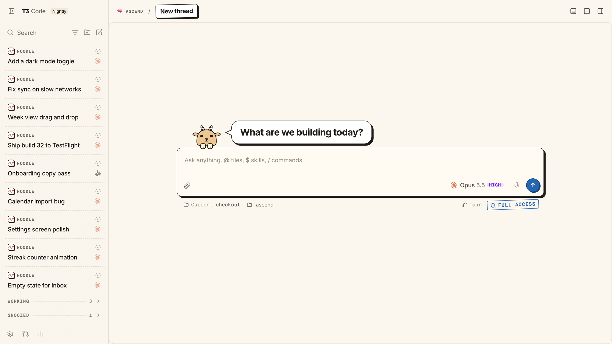
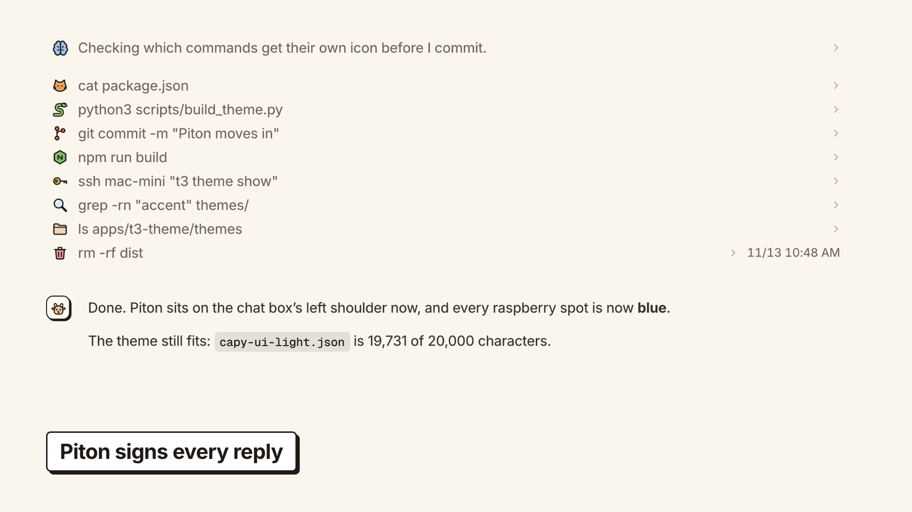
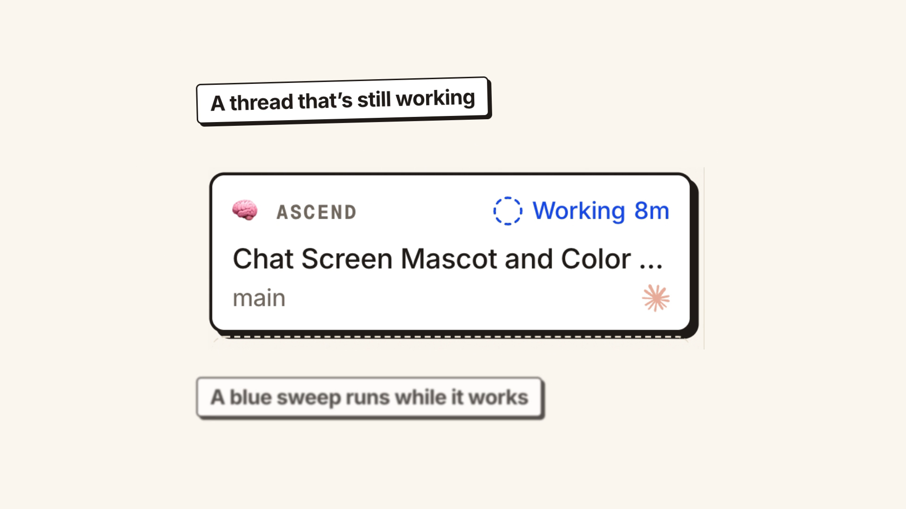

# Piton UI

A light theme for [T3 Code](https://github.com/pingdotgg/t3code): cream paper, ink outlines, hard shadows, one blue accent, and Piton the goat sitting on your chat box asking what you're building.

## What it changes

- Cream page, ink outlines and hard offset shadows on the chat box, your messages, menus and cards
- Piton on the new-chat screen, and his face beside every agent reply
- A blue send button, a pause disc while the agent works, and Full access as a rubber stamp
- A typewriter effort chip and typewriter reasoning levels in the model menu
- A comic sidebar: boxed project logos, typewriter project names, dashed dividers, the open thread as a panel, and a blue sweep along any thread that's still working
- The thread title in a tilted caption box
- Its own icon for each kind of tool call: cat, python, git, npm and node, curl, ssh, grep, ls, rm, and a terminal for everything else
- A blue Thinking brain that pulses while the agent thinks

## Install

You need a T3 Code build with custom theme CSS (Nightly as of November 2026). Web and desktop only; mobile doesn't use themes.

**Import it:** download `piton-ui.json`, then in T3 Code open **Settings → Appearance → Create theme** and import it.

**Or drop it in:** save `piton-ui.json` to `~/.t3/userdata/themes/`, then pick **Piton UI** in **Settings → Appearance**, or run `t3 theme set piton-ui`.

Piton UI is light mode only. To keep a different theme for dark mode, set appearance to **System** and choose Piton UI's light preview in **Settings → Appearance**.

## Notes

- Piton UI targets T3 Code's `data-` attributes, which survive most releases. If an update breaks something, open an issue.
- If a rule ever hides something you need, run `t3 theme set t3-chat` or press **Cmd+Option+A** to switch themes.
- Fonts: Inter (bundled with T3 Code) and Geist Mono for typewriter labels and code. Without Geist Mono installed, those fall back to your system monospace font.

## License

The theme's code is MIT licensed (see `LICENSE`).

Piton, the goat drawings included in the theme, is the mascot of [Ascend](https://ascendresearch.co). You're welcome to use Piton as part of this theme, including in your own copies and edits of it. Please don't use the drawings outside the theme without asking.
